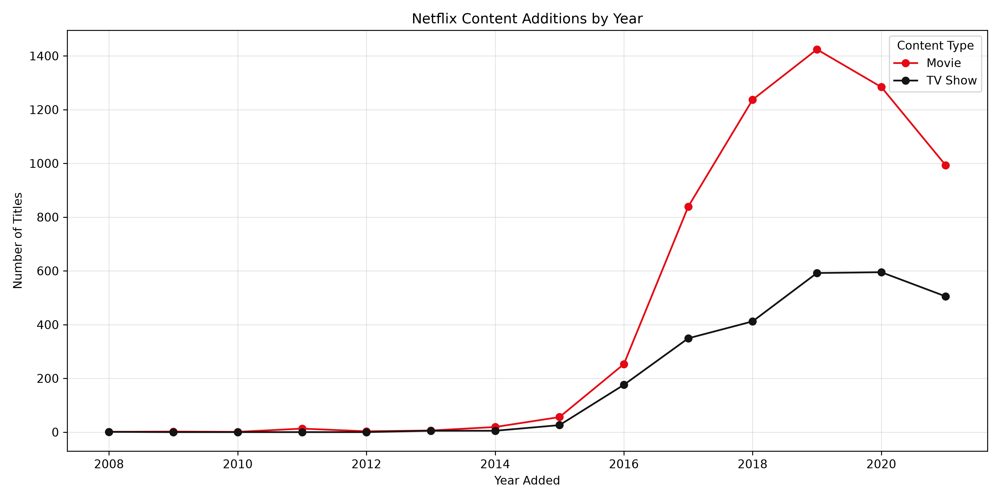
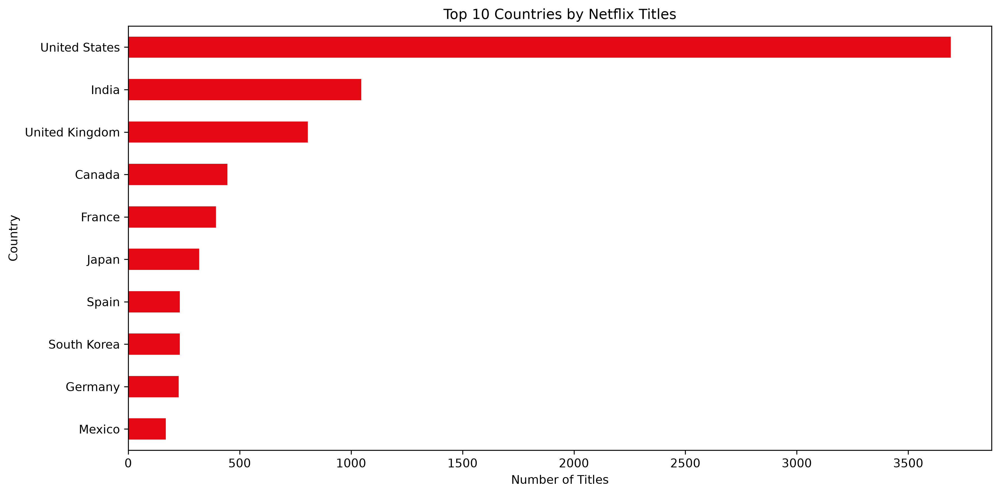

# 🎬 Netflix Content Strategy & Catalog Analysis

> A comprehensive Exploratory Data Analysis (EDA) and data wrangling project built with Python to map catalog trends, global expansion strategies, and content patterns on Netflix.

---

## 🎯 Business Context & The Problem
In the modern streaming market, understanding catalog dynamics is vital for user retention, platform engagement, and content acquisition strategy. This project was developed to answer critical business questions:
* **What is the ideal portfolio mix?** (The balance between Movies and TV Shows).
* **When was the tipping point in global expansion?** (Tracking the exponential growth timeline of content additions).
* **Which geographic markets and content categories drive the highest volume of production and delivery?**

---

## 🛠️ Tech Stack & Architecture
* **Language:** Python 3.x
* **Data Manipulation & Cleaning:** Pandas, NumPy
* **Data Visualization:** Matplotlib, Seaborn
* **Environment:** VS Code, Git & GitHub

---

## 🧹 Data Pipeline & Wrangling (Data Engineering)
Real-world data is inherently noisy. The developed script executes a robust cleaning pipeline:
1. **Missing Value Treatment:** Strategic imputation of missing categorical values (such as *director*, *cast*, and *country*) to preserve analytical volume.
2. **Advanced Data Cleaning:** Resolving structural inconsistencies (such as movie durations mistakenly stored inside the rating column).
3. **Feature Engineering:** Converting temporal strings into proper `datetime` objects (extracting release/addition years and months) and normalizing multi-valued columns (countries and genres) using Pandas' `.explode()` method for precise statistical counts.

---

## 📈 Key Insights & Business Takeaways
* **Movie Dominance:** Approximately **69.6%** of the analyzed global catalog consists of movies, highlighting a heavy focus on quick-consumption options compared to TV Shows (30.4%).
* **The 2016 Boom:** The data reveals an aggressive exponential surge in content additions starting around 2016, directly reflecting the platform's global pivot toward original productions.
* **Geographical Footprint:** The *United States* and *India* lead the production volume by a wide margin, followed by emerging powerhouses like South Korea and Spain.

---

## 📊 Sample Visualizations
<p align="center">
  
  
</p>

---

## 🚀 How to Run the Project
```bash
# Clone this repository
git clone [https://github.com/Thaynacarvalho98/netflix-data-analysis.git]

# Install the required dependencies
pip install pandas numpy matplotlib seaborn

# Run the main analysis and cleaning script
python analysis_netflix.py

---

⌨️ Desenvolvido por **Thayná Marques** | [LinkedIn](https://www.linkedin.com/in/thayna-m-carvalho/)

